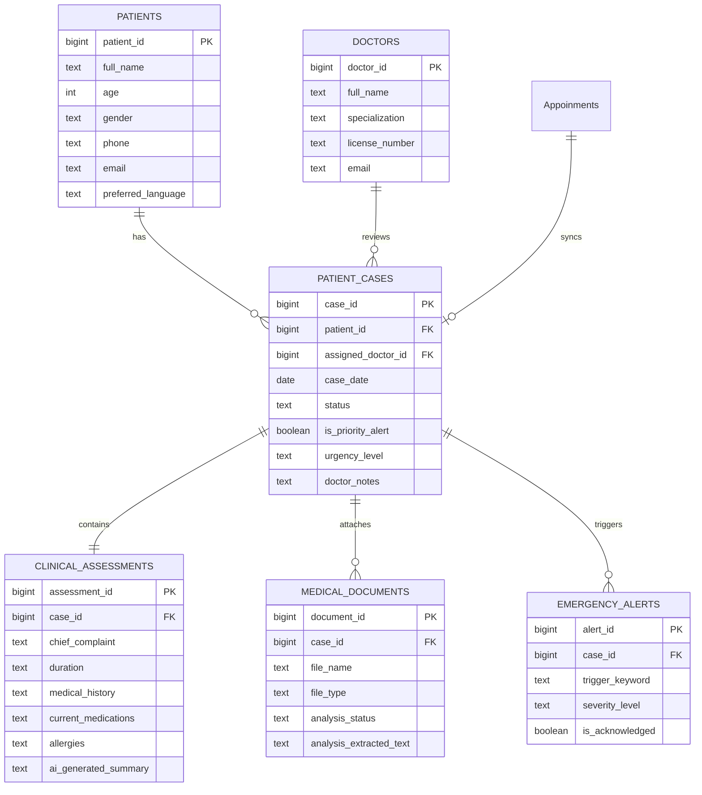

# SAARTHI AI Healthcare — Database Specification & Implementation

Database implementation and relational schema designed for **[SAARTHI | AI Healthcare](https://divya-sharma-82.github.io/saarthi-healthcare/)**.

---

## 1. Architecture Overview

SAARTHI AI is an intelligent patient intake and triage platform that:
1. **Interviews Patients:** Guides patients through multi-turn clinical questioning (voice or text in English and Hindi).
2. **Screens for Emergencies:** Real-time triage detection for high-acuity keywords (*chest pain, difficulty breathing, stroke, severe bleeding*).
3. **Generates Case Summaries:** Synthesizes patient responses into structured medical summaries.
4. **Doctor Verification Dashboard:** Enables medical practitioners to review, verify, and prioritize incoming cases.

```
       [ Patient Intake ]              [ Medical Reports ]
       (Voice/Text Chat)               (PDF / Image Upload)
               │                                │
               ▼                                ▼
       ┌─────────────────────────────────────────────────┐
       │             SAARTHI AI FRONTEND                 │
       │    (https://divya-sharma-82.github.io/...)      │
       └─────────────────────────────────────────────────┘
                               │
               ┌───────────────┴───────────────┐
               ▼                               ▼
       [ Cloud: Supabase ]            [ Local: SQLite ]
       PostgreSQL Database             `database/saarthi.db`
       • Table: "Appoinments"         • Table: Appoinments
       • Triggers & Views              • Views & Foreign Keys
       • Normalized Schema             • Local REST Server (server.py)
```

---

## 2. Directory Contents

| File | Description |
| :--- | :--- |
| **[`schema.sql`](./schema.sql)** | **Production PostgreSQL / Supabase Schema** with table definitions, RLS security policies, automatic message parser trigger, and dashboard views. |
| **[`schema_sqlite.sql`](./schema_sqlite.sql)** | **Local SQLite Schema** for offline/embedded execution. |
| **[`seed_data.sql`](./seed_data.sql)** | Comprehensive test records (Rahul Sharma, Anjali Singh, Aman Verma, etc.) in English and Hindi. |
| **[`saarthi.db`](./saarthi.db)** | **Active pre-built SQLite Database** ready to query or open in SQLite tools (DBeaver, DB Browser for SQLite). |
| **[`init_db.py`](./init_db.py)** | Python automation script to rebuild, seed, and verify database integrity. |
| **[`server.py`](./server.py)** | Lightweight REST API server providing Supabase-compatible PostgREST endpoints locally. |

---

## 3. Database Schema Design

### 3.1. Primary App Table (`Appoinments`)
Matches the exact table queried by the live frontend JavaScript (`script.js`):
```sql
CREATE TABLE public."Appoinments" (
    id            BIGINT GENERATED BY DEFAULT AS IDENTITY PRIMARY KEY,
    name          TEXT NOT NULL,
    phone         TEXT DEFAULT '',
    date          DATE DEFAULT CURRENT_DATE,
    message       TEXT,
    status        TEXT DEFAULT 'Pending' CHECK (status IN ('Pending', 'Verified', 'Review', 'Completed')),
    is_emergency  BOOLEAN DEFAULT FALSE,
    created_at    TIMESTAMPTZ DEFAULT timezone('utc'::text, now()) NOT NULL
);
```

#### Message Structure Format:
The frontend packages intake questionnaire responses into the `message` column formatted as:
```text
Age: <age>
Health Problem: <chief complaint>
Duration: <symptom duration>
Medical History: <past history>
Medicines: <current medications>
```

---

### 3.2. Normalized Relational Schema

For enterprise deployments and clinical integrations, the schema also provides fully normalized tables:



---

## 4. Setup Instructions

### Option A: Using with Cloud Supabase (Live Web App)

1. Open your [Supabase Dashboard](https://supabase.com/dashboard).
2. Go to the **SQL Editor** tab.
3. Open [`database/schema.sql`](./schema.sql), copy its entire content, and paste it into the Supabase SQL Editor.
4. Click **Run**.
5. All tables, indexes, triggers, and Row-Level Security (RLS) policies will be provisioned.
6. The frontend at `https://divya-sharma-82.github.io/saarthi-healthcare/` will now read and write directly to your database.

---

### Option B: Local SQLite Execution (Offline / Embedded)

Re-initialize or inspect the local database using Python:

```powershell
# Initialize and verify database
python database/init_db.py
```

Run the local API server (mimics Supabase REST endpoints on `http://localhost:8000`):

```powershell
python database/server.py 8000
```

#### Available Endpoints:
- `GET /rest/v1/Appoinments?order=id.desc`: List all appointments (matches Supabase PostgREST)
- `POST /rest/v1/Appoinments`: Insert new appointment
- `GET /api/stats`: Real-time dashboard statistics (`total_patients`, `pending_cases`, `verified_cases`, `priority_alerts`)
- `GET /api/patients`: Detailed normalized patient records
